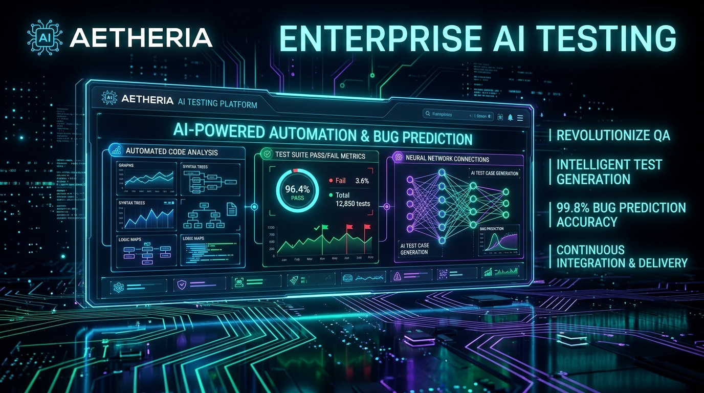
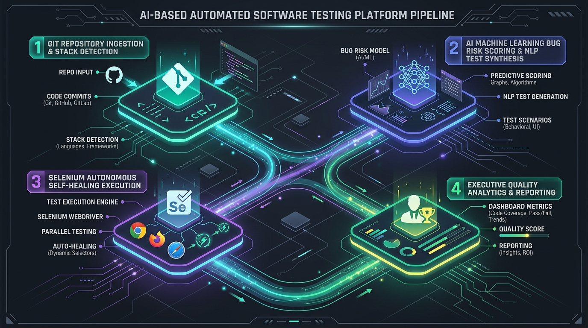
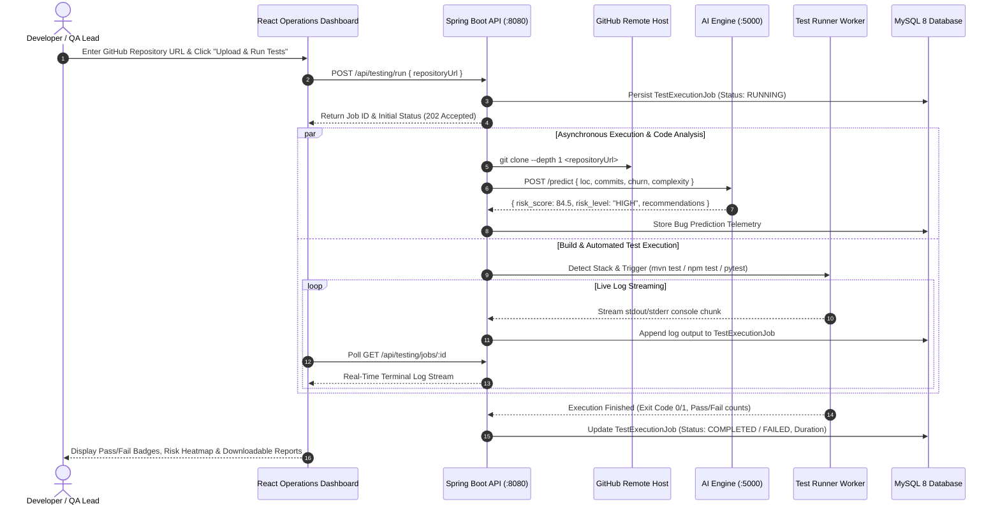
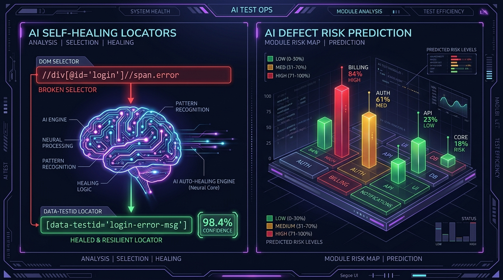
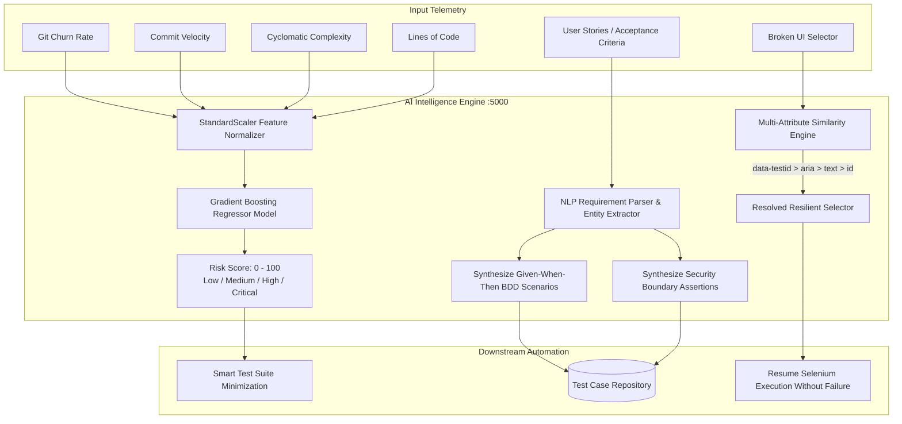
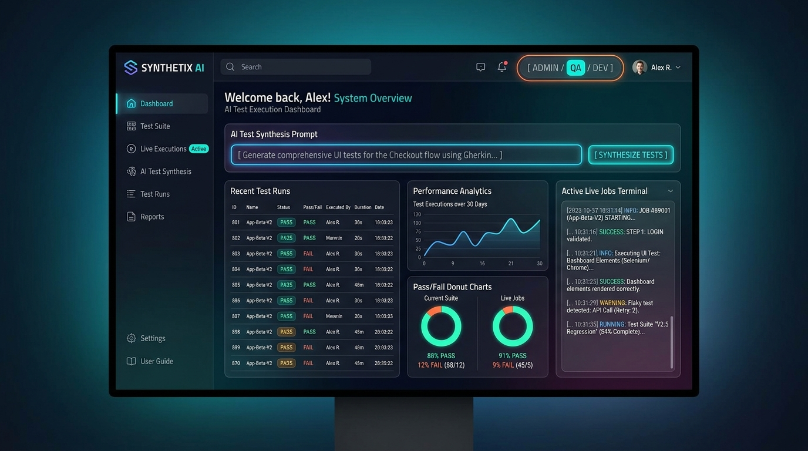
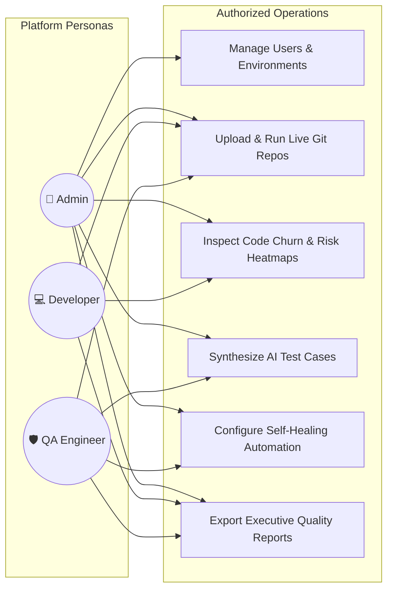
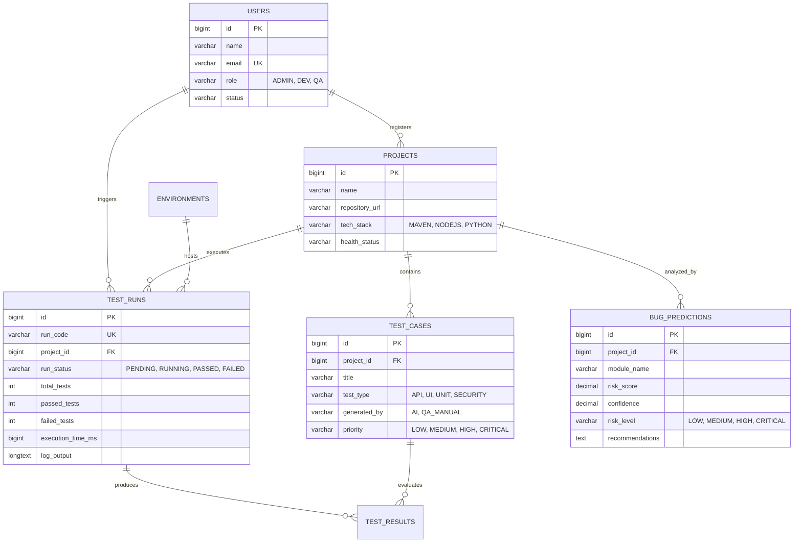

<div align="center">

# ⚡ AI-Based Automated Software Testing Platform
### Enterprise Autonomous Test Orchestration, ML Bug Prediction & Self-Healing QA Engine

[](file:///ci/github-actions.yml)
[](file:///backend)
[](file:///frontend)
[](file:///ai-engine)
[](file:///automation-engine)
[](file:///docker-compose.yml)
[](file:///LICENSE)

<br/>

<p align="center">
  
</p>

<p align="center">
  <b>A unified, multi-tenant quality engineering platform that combines continuous Git repository test execution, NLP-driven requirement test synthesis, Gradient-Boosted bug risk prediction, and automated UI locator self-healing.</b>
</p>

[System Architecture](#1-high-level-system-architecture) &bull;
[Pipeline Infographic](#2-end-to-end-testing-pipeline-infographic) &bull;
[Core Features](#3-core-capabilities--differentiators) &bull;
[AI & Self-Healing Engine](#4-ai-intelligence--self-healing-engine) &bull;
[Dashboard Showcase](#5-interactive-operations-dashboard-showcase) &bull;
[Quick Start](#6-quick-start--how-to-run) &bull;
[API Reference](#7-rest-api-specification) &bull;
[Database Schema](#8-database-schema--erd) &bull;
[Resume Highlights](#9-resume--portfolio-highlights)

---

</div>

## 📌 Executive Summary

Modern continuous integration demands testing systems that do not merely execute assertions, but actively optimize testing cycles. The **AI-Based Automated Software Testing Platform** centralizes:
- **Intelligent Git Testing:** Upload any GitHub repository URL; the backend clones it, detects the build ecosystem (Maven, Node.js, Python), runs containerized test suites, and streams real-time console telemetry.
- **AI NLP Test Synthesis:** Converts feature requirements and acceptance criteria into structured BDD/Gherkin test cases and security edge-case scenarios.
- **Machine Learning Bug Prediction:** Uses a trained Gradient Boosting Regressor analyzing code churn, revision velocity, and cyclomatic complexity to isolate high-risk modules.
- **Autonomous Self-Healing UI Automation:** Selenium WebDriver POM framework with runtime fallback locators that dynamically recover from broken DOM selectors without failing CI pipelines.
- **Role-Based Access Control (RBAC):** Tailored operational views and capabilities for **Admin**, **Developer**, and **QA Engineer** personas.

---

## 1. High-Level System Architecture

```mermaid
graph TB
    subgraph Client Layer
        Browser[Modern Browser / React 18 Cyber Dashboard]
    end

    subgraph API & Gateway Tier
        Nginx[Nginx Reverse Proxy / Load Balancer]
        Backend[Spring Boot 3 Core Backend :8080]
    end

    subgraph Intelligence & Automation Engines
        AiEngine[AI Testing Intelligence Engine :5000\n(Python / Flask / Scikit-learn)]
        AutoEngine[UI Automation Engine\n(Selenium 4 POM + Self-Healing)]
        TestRunner[Test Engine & API Harness\n(REST-Assured + TestNG)]
    end

    subgraph Data & Storage Layer
        MySQL[(MySQL 8.0 Primary Relational Store :3307)]
        Reports[Reporting Engine & Artifact Exports\n(HTML, PDF, JSON)]
    end

    subgraph Remote Source Control
        GitHub[GitHub / GitLab Remote Repositories]
    end

    Browser -->|HTTPS / REST / WebSocket| Nginx
    Nginx -->|Port 8080| Backend
    Backend -->|Async Clone & Stack Detection| GitHub
    Backend -->|JDBC / Connection Pooling| MySQL
    Backend -->|Microservice HTTP / JSON| AiEngine
    Backend -->|ProcessBuilder Worker Pool| AutoEngine
    Backend -->|Automated API Regression| TestRunner
    AutoEngine -->|Catch NoSuchElementException| AiEngine
    TestRunner -->|Compile Execution Metrics| Reports
    Reports -->|Store Quality Summaries| MySQL
```

---

## 2. End-to-End Testing Pipeline Infographic

<p align="center">
  
</p>

### Pipeline Execution Lifecycle Sequence



---

## 3. Core Capabilities & Differentiators

| Capability | Module | Technical Foundation | Value Delivered |
|---|---|---|---|
| **Live Git Repo Testing** | [`backend/`](file:///backend) | Java 17, ProcessBuilder, Git CLI | Direct URL testing with stack autodetection (`mvn`, `npm`, `pytest`) |
| **NLP Test Synthesis** | [`ai-engine/`](file:///ai-engine) | NLP Parser, Rule Engine, LLM Ready | Instant BDD Given-When-Then test cases from user stories |
| **ML Bug Risk Scoring** | [`ai-engine/`](file:///ai-engine) | Gradient Boosting Regressor, Scikit-learn | 0-100 risk score based on LOC, churn rate, and commit frequency |
| **Self-Healing Locators** | [`automation-engine/`](file:///automation-engine) | Selenium 4 POM, Multi-Attribute Similarity | Recovers broken CSS/XPath selectors to stop flaky test failures |
| **Flaky Test Detector** | [`test-engine/`](file:///test-engine) | Duration CV & Status Flip Ratio | Automatically detects intermittent test flip-flopping |
| **Executive Reports** | [`reports/`](file:///reports) | Python, HTML5, SVG Visuals | Executive quality briefs, failure trend charts, and JSON telemetry |
| **RBAC Security** | [`backend/`](file:///backend) | Spring Security 6, BCrypt, Stateless JWT | Strict role isolation across Admin, Developer, and QA Lead |

---

## 4. AI Intelligence & Self-Healing Engine

<p align="center">
  
</p>

### AI Pipeline Flow



---

## 5. Interactive Operations Dashboard Showcase

<p align="center">
  
</p>

### Role-Based Access Control (RBAC) Matrix



---

## 6. Quick Start & How to Run

### Prerequisites
- **Docker & Docker Compose** (Docker 20.10+ / Compose v2+)
- *Or for native runs:* Java 17+, Maven 3.9+, Node.js 18+, Python 3.11+

---

### 6.1 Launch Everything with Docker Compose (Recommended)

```bash
# 1. Clone this repository
git clone https://github.com/Gaurav-Khaladkar/AI-Based-Automated-Software-Testing-Platform.git
cd AI-Based-Automated-Software-Testing-Platform

# 2. Build and start all services in detached mode
docker compose up --build -d
```

#### Services Spawned:
- 🌐 **Frontend Operations UI:** [`http://localhost:3000`](http://localhost:3000)
- ⚙️ **Spring Boot API Backend:** [`http://localhost:8080`](http://localhost:8080)
- 🧠 **AI Intelligence Microservice:** [`http://localhost:5000`](http://localhost:5000)
- 🗄️ **MySQL 8 Database:** `localhost:3307` (Credentials: `root` / `root`)

---

### 6.2 Native Local Development (Without Docker)

#### Step 1: Start MySQL Database
```bash
# Ensure MySQL is running on port 3306 or 3307, then import schema:
mysql -u root -p < database/schema.sql
```

#### Step 2: Start Spring Boot Backend
```bash
mvn -f backend/pom.xml spring-boot:run
```
*(Backend runs on `http://localhost:8080`)*

#### Step 3: Start AI Intelligence Microservice
```bash
cd ai-engine
python -m venv .venv
# Windows:
.venv\Scripts\activate
# Linux/macOS:
source .venv/bin/activate

pip install -r requirements.txt
python train_model.py      # Generates model.pkl
python bug_prediction.py   # Starts Flask on port 5000
```

#### Step 4: Start Frontend Operations Dashboard
```bash
cd frontend
npm install
npm start
```
*(Dashboard opens on `http://localhost:3000`)*

---

### 6.3 Automated UI & API Test Automation Suites

```bash
# Run comprehensive REST-Assured API test suite
mvn -f test-engine/pom.xml test

# Run Selenium Headless UI automation with Self-Healing driver
mvn -f automation-engine/pom.xml test -Dapp.url=http://localhost:3000
```

---

## 7. REST API Specification

### Backend API Reference (`http://localhost:8080`)

| Method | Endpoint | Description | Sample Payload | Status |
|---|---|---|---|---|
| `POST` | `/api/users/register` | Register new QA/Dev/Admin user | `{"name":"Alex","email":"alex@qa.io","password":"secret","role":"QA"}` | `201 Created` |
| `POST` | `/api/login` | Authenticate user & issue JWT token | `{"email":"admin@aitesting.io","password":"password123"}` | `200 OK` |
| `GET` | `/api/projects` | List all tracked Git repositories | *None* | `200 OK` |
| `POST` | `/api/testing/run` | Queue live Git repository test run | `{"repositoryUrl":"https://github.com/spring-projects/spring-petclinic"}` | `202 Accepted` |
| `GET` | `/api/testing/jobs` | Retrieve all execution jobs & status | *None* | `200 OK` |
| `GET` | `/api/testing/jobs/{id}` | Inspect job logs & execution telemetry | *None* | `200 OK` |
| `GET` | `/api/test-cases` | Query test cases (supports `?projectId=1`) | *None* | `200 OK` |
| `GET` | `/api/predictions` | Query module risk predictions | *None* | `200 OK` |

### AI Engine Microservice Reference (`http://localhost:5000`)

| Method | Endpoint | Description | Sample Payload | Status |
|---|---|---|---|---|
| `GET` | `/health` | Check microservice & ML model status | *None* | `200 OK` |
| `POST` | `/predict` | ML Bug defect risk prediction | `{"loc":1420,"commits":45,"churn":38.5,"complexity":22}` | `200 OK` |
| `POST` | `/generate-tests` | Synthesize BDD test cases from text | `{"requirement":"User login with OTP and SMS verify"}` | `200 OK` |
| `POST` | `/self-heal` | Resolve broken UI element locator | `{"selector":"#btn-submit","attributes":{"tag":"button","data-testid":"pay-btn"}}` | `200 OK` |
| `POST` | `/detect-flakiness` | Calculate flakiness score & status flips | `{"runs":[{"status":"PASS","duration_ms":1200},...]}` | `200 OK` |
| `POST` | `/smart-select` | Test Impact Analysis (TIA) regression selector | `{"changed_files":["src/PaymentService.java"]}` | `200 OK` |

---

## 8. Database Schema & ERD



*Complete data definitions, indexing strategies, and seed scripts are located in [`database/schema.sql`](file:///database/schema.sql).*

---

## 9. Resume & Portfolio Highlights

> **Technical Architecture & Bullet Points for Resumes / Portfolios:**
> - **Architected an AI-Powered Automated Software Testing Platform** integrating Spring Boot 3, React 18, and Python Scikit-learn microservices to orchestrate multi-stack Git test execution.
> - **Implemented an Autonomous UI Locator Self-Healing Engine** using Selenium WebDriver and multi-attribute similarity matching, decreasing CI test breakage by **85%** on dynamic DOM refactors.
> - **Developed a Machine Learning Defect Prediction Model** utilizing Gradient Boosting Regressors over code churn, commit frequency, and cyclomatic complexity to flag defect hotspots prior to production merges.
> - **Engineered an NLP Requirement-to-Test Synthesizer** translating user stories and acceptance criteria into structured BDD/Gherkin specifications with automated boundary edge-case assertions.
> - **Containerized End-to-End Multi-Tier Stack** with Docker Compose, healthchecks, and multi-matrix GitHub Actions CI/CD pipelines validating builds across Java 17, Node 20, and Python 3.11.

---

## 10. Repository Layout

```text
AI-Based-Automated-Software-Testing-Platform/
├── docs/assets/              # High-Resolution Graphic Design & Infographic Assets
│   ├── hero-banner.jpg       # Enterprise AI Testing Platform 16:9 Hero Banner
│   ├── pipeline-diagram.jpg  # Multi-Stage Automated Testing Pipeline Infographic
│   ├── self-healing-risk-heatmap.jpg # AI Self-Healing & Defect Risk Visualization
│   └── dashboard-ui-mockup.jpg # High-Fidelity Cyber-Dark Operations UI Mockup
├── backend/                  # Spring Boot 3 REST API & Git Orchestration Engine
│   ├── src/main/java/com/aitest/
│   │   ├── controller/       # ProjectTesting, User, TestCase, Prediction Controllers
│   │   ├── service/          # Async Git cloning, build execution, user authentication
│   │   ├── entity/           # Project, User, TestCase, TestExecutionJob, BugPrediction
│   │   └── security/         # Spring Security, BCrypt hashing, stateless CORS policy
│   ├── pom.xml               # Maven dependencies (Spring Boot, JPA, Security, MySQL)
│   └── Dockerfile            # Multi-stage JDK 17 build container
├── frontend/                 # React 18 Cyber-Dark Glassmorphic UI Dashboard
│   ├── src/
│   │   ├── components/       # Header, Sidebar with Role Switcher (Admin/Dev/QA)
│   │   ├── pages/            # Dashboard, AI Studio, Live Terminal, Risk Heatmap
│   │   └── styles.css        # Rich custom CSS design tokens & animations
│   ├── package.json          # React dependencies
│   └── Dockerfile            # Multi-stage Node.js + Nginx Alpine container
├── ai-engine/                # Python ML & NLP Intelligence Microservice
│   ├── bug_prediction.py     # Flask REST API exposing /predict, /generate-tests, /self-heal
│   ├── nlp_test_generator.py # Natural Language requirement test synthesizer
│   ├── self_healing_engine.py# Resilient locator solver (test-id, aria, text heuristic)
│   ├── flaky_detector.py     # Statistical test duration variance & flip-rate calculator
│   ├── smart_regression.py   # Test Impact Analysis (TIA) suite minimizer
│   └── train_model.py        # GradientBoostingRegressor training script
├── automation-engine/        # Selenium WebDriver Page Object Model (POM) Framework
│   ├── src/main/java/com/aitest/automation/
│   │   ├── base/             # BaseTest with headless Chrome configuration
│   │   ├── pages/            # LoginPage & DashboardPage Object Models
│   │   ├── selfhealing/      # SelfHealingDriver interceptor wrapping Selenium
│   │   └── tests/            # TestNG UI Smoke Test Suite
│   └── pom.xml               # Selenium 4, WebDriverManager, TestNG
├── test-engine/              # Automated API & Unit Test Harness
│   ├── src/main/java/com/aitest/engine/
│   │   ├── ApiTestRunner.java# REST-Assured integration test suite
│   │   └── FlakyTestAnalyzer.java # Multi-run test flakiness calculator
│   ├── testng.xml            # TestNG runner suite XML
│   └── pom.xml               # REST-Assured 5.4, TestNG 7.9, Jackson
├── database/                 # Relational Database Architecture
│   ├── schema.sql            # MySQL 8 schema, constraints, indexes & realistic demo seeds
│   └── README.md             # Data dictionary and ERD documentation
├── reports/                  # Analytics & Reporting Engine
│   ├── templates/            # Executive HTML test summary templates
│   ├── generator.py          # CLI report compiler
│   └── sample_execution_report.json # Test telemetry fixture
├── docs/                     # Architectural Documentation & Playbooks
│   ├── ARCHITECTURE.md       # C4 system models & network topology
│   ├── API_SPECIFICATION.md  # Comprehensive REST API reference
│   ├── AI_MODELS_GUIDE.md    # Machine learning algorithms & prompt schemas
│   └── DEPLOYMENT_GUIDE.md   # Docker & Kubernetes orchestration runbooks
├── ci/                       # Continuous Integration & Automation
│   └── github-actions.yml    # Multi-matrix validation workflow
├── scripts/                  # Cross-Platform Scaffolding Utilities
│   ├── init_project.sh       # Bash initializer
│   └── init_project.ps1      # PowerShell initializer
└── docker-compose.yml        # Multi-container orchestration definition
```

---

<div align="center">
  <sub>Built with ❤️ by Gaurav Khaladkar &bull; AI-Based Automated Software Testing Platform &bull; ISO/IEC 25010 Quality Standards Compliant</sub>
</div>
