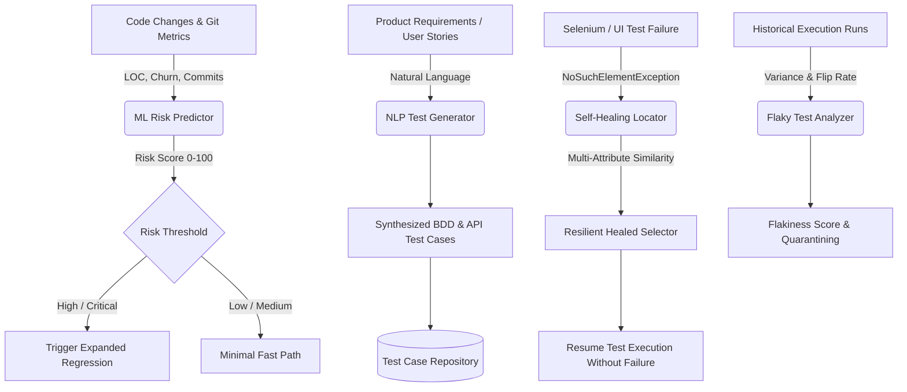

# AI Testing Intelligence Engine (ML & NLP)

The **AI Testing Intelligence Engine** is a high-performance Python microservice that introduces machine learning, NLP test synthesis, and self-healing automation to modern CI/CD pipelines.

---

## 1. Intelligence Pipeline (Mermaid)



---

## 2. Capabilities & Endpoints

| Endpoint | Method | Input Parameters | Output / Action |
|---|---|---|---|
| `/health` | `GET` | None | Service status & active ML model metadata |
| `/predict` | `POST` | `loc`, `commits`, `churn`, `complexity` | 0-100 Risk score, risk level, confidence, and action items |
| `/generate-tests` | `POST` | `requirement`, `project_name` | Synthesized unit, API, UI, and security test cases |
| `/detect-flakiness` | `POST` | Array of test runs `[{status, duration_ms}]` | Flakiness score, flip rate, and stability verdict |
| `/self-heal` | `POST` | `selector`, DOM `attributes` | Resilient alternative CSS/XPath locators with confidence |
| `/smart-select` | `POST` | `changed_files` list | Test impact analysis (TIA) minimal regression suite |

---

## 3. Sample cURL Requests

### Bug Risk Prediction
```bash
curl -X POST http://localhost:5000/predict \
  -H "Content-Type: application/json" \
  -d '{"module":"PaymentGateway","loc":1420,"commits":48,"churn":38.5,"complexity":24}'
```

### NLP Test Synthesis
```bash
curl -X POST http://localhost:5000/generate-tests \
  -H "Content-Type: application/json" \
  -d '{"requirement":"User checkout with 3D Secure credit card payment and promo code"}'
```

### Self-Healing Element Recovery
```bash
curl -X POST http://localhost:5000/self-heal \
  -H "Content-Type: application/json" \
  -d '{"selector":"#btn-checkout-v1","attributes":{"tag":"button","data-testid":"checkout-btn","text":"Place Order"}}'
```
