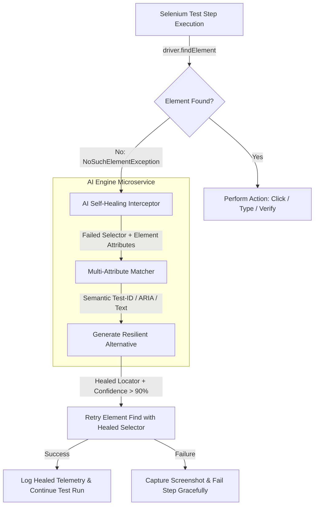

# UI Automation Engine (Selenium & AI Self-Healing)

The **Automation Engine** is an enterprise Page Object Model (POM) Selenium automation framework featuring AI-powered locator self-healing to eliminate flaky tests caused by UI DOM changes.

---

## 1. Self-Healing Architecture (Mermaid)



---

## 2. Framework Highlights

- **Page Object Model (POM):** Decoupled UI page representations (`LoginPage`, `DashboardPage`) from test logic.
- **Headless Chrome Execution:** Configured for local dev and headless CI/CD runner pipelines.
- **AI Self-Healing Driver Wrapper:** Intercepts runtime locator breakages and resolves dynamic selectors without aborting CI builds.
- **TestNG Integration:** Parallel test execution, data-driven tests, and structured reporting.

---

## 3. Quick Execution

```bash
# Run Selenium UI Smoke Test Suite against local frontend
mvn -f automation-engine/pom.xml test -Dapp.url=http://localhost:3000
```
