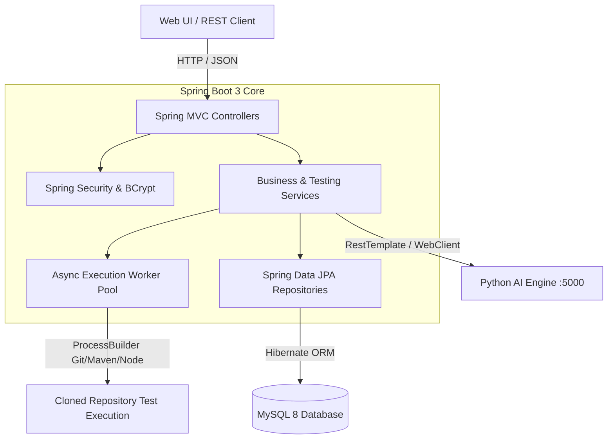

# Backend API & Test Orchestrator (Spring Boot)

The **Backend Core** is a robust Spring Boot 3 service that handles project registration, Git repository cloning, asynchronous test job dispatch, and AI microservice coordination.

---

## 1. Backend Architecture (Mermaid)



---

## 2. API Endpoints Catalog

| Context | Method | Path | Function |
|---|---|---|---|
| **Auth** | `POST` | `/api/users/register` | Register QA / Dev / Admin user |
| **Auth** | `POST` | `/api/login` | Verify credentials & issue JWT token |
| **Projects** | `GET` | `/api/projects` | List all tracked Git repositories |
| **Projects** | `POST` | `/api/projects` | Register a new project |
| **Testing** | `POST` | `/api/testing/run` | Queue live Git repository test job |
| **Testing** | `GET` | `/api/testing/jobs` | Retrieve live & historical jobs |
| **Testing** | `GET` | `/api/testing/jobs/{id}` | Stream job console logs |
| **Test Cases** | `GET` | `/api/test-cases` | List manual and AI-synthesized test cases |
| **Predictions** | `GET` | `/api/predictions` | Query module risk scores |

---

## 3. Local Startup

```bash
# Run Spring Boot service
mvn -f backend/pom.xml spring-boot:run
```
