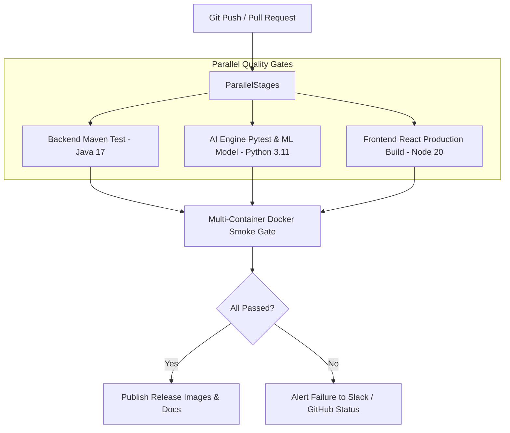

# Continuous Integration & Delivery Pipeline

This directory defines automated workflows and quality gates for the **AI-Based Automated Software Testing Platform**.

---

## 1. Pipeline Stages (Mermaid)

---

## 2. Configured Workflow Triggers

- **Mainline Branch Protection:** Triggers on all pushes to `main` and `release/*`.
- **Pull Request Gating:** Validates all pull requests before merging.
- **Docker Compose Integration:** Validates multi-service health across MySQL, Spring Boot, Flask, and React.
