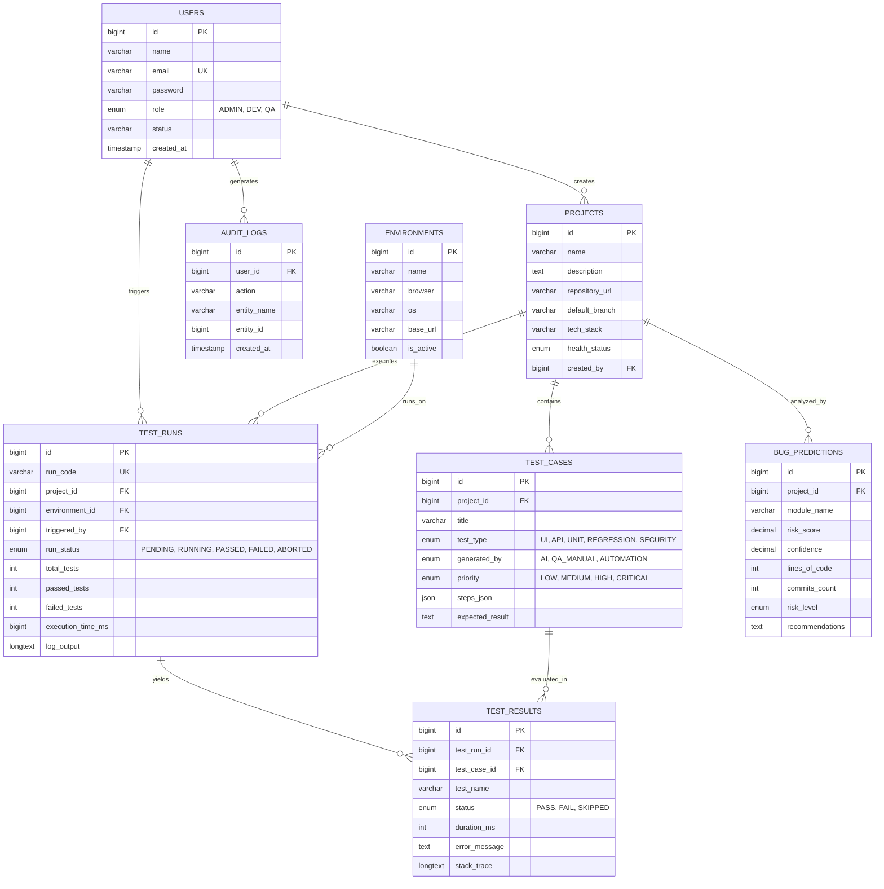

# Database Architecture & Data Dictionary

Comprehensive relational database model supporting the **AI-Based Automated Software Testing Platform**. Engineered for multi-tenant scalability, ACID transactions, and sub-millisecond query performance on test execution logs and AI analytics.

---

## 1. Entity-Relationship Diagram (Mermaid)



---

## 2. Table Catalog

| Table | Primary Role | Indexing Key |
|---|---|---|
| `users` | Secure identity, BCrypt credentials, RBAC permissions | `email (UNIQUE)`, `role` |
| `projects` | Git repository registry, technology stack identification | `name` |
| `environments` | Matrix of execution browsers, OS, and remote endpoints | `id` |
| `test_cases` | Catalog of manual and AI-synthesized test specifications | `project_id`, `test_type`, `generated_by` |
| `test_runs` | Orchestrated suite execution runs, status, and aggregated metrics | `run_code (UNIQUE)`, `run_status`, `project_id` |
| `test_results` | Granular per-test outcome, failure traces, execution latency | `test_run_id`, `status` |
| `bug_predictions`| ML risk assessment, churn metrics, and AI recommendations | `project_id`, `risk_level` |
| `audit_logs` | Compliance tracking and user interaction audit trail | `user_id`, `created_at` |

---

## 3. Quick Initialization

```bash
# Via Docker Compose (Recommended)
docker-compose exec db mysql -u root -proot ai_testing < database/schema.sql

# Native MySQL CLI
mysql -h localhost -P 3307 -u root -p < database/schema.sql
```
