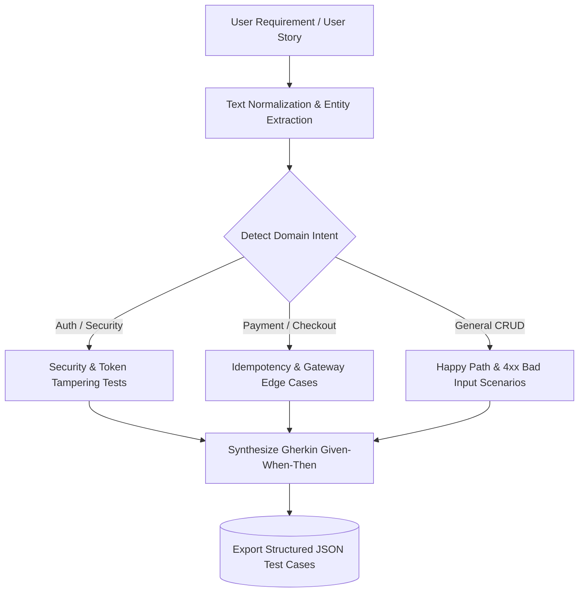

# AI & Machine Learning Testing Intelligence Guide

This guide details the mathematical and algorithmic foundation of the machine learning and NLP components driving the **AI-Based Automated Software Testing Platform**.

---

## 1. Machine Learning Bug Risk Prediction

### Model Topology
- **Algorithm:** Gradient Boosting Regressor (`scikit-learn`)
- **Loss Function:** Squared Error with shrinkage (`learning_rate=0.1`)
- **Ensemble Depth:** 100 decision trees (`max_depth=3`)
- **Preprocessing:** Standard Z-score feature scaling (`StandardScaler`)

### Feature Vector Formulation

$$\mathbf{x} = \begin{bmatrix} \text{LOC} & \text{Commits} & \text{Churn Rate} & \text{Complexity} \end{bmatrix}^T$$

| Feature | Description | Typical Range | Correlation to Bugs |
|---|---|---|---|
| **LOC** | Total lines of code in modified module | $10 - 10,000+$ | Moderate positive |
| **Commits** | Number of revisions within the sprint window | $1 - 100+$ | High positive |
| **Churn Rate** | Percentage of code lines added, modified, or removed | $0.0\% - 100.0\%$ | Extremely high positive |
| **Complexity** | Cyclomatic complexity (McCabe metric) | $1 - 80+$ | High positive |

### Risk Level Categorization
- **$0 \le \text{Score} < 25$:** `LOW` — Stable components with established test suites.
- **$25 \le \text{Score} < 50$:** `MEDIUM` — Standard automated CI regression checks sufficient.
- **$50 \le \text{Score} < 75$:** `HIGH` — Elevated defect probability; expand unit test edge cases.
- **$75 \le \text{Score} \le 100$:** `CRITICAL` — Hotspot module; mandatory QA peer validation before merge.

---

## 2. NLP Test Case Generation Pipeline

---

## 3. UI Element Self-Healing Algorithm

When Selenium encounters `NoSuchElementException`, the Self-Healing engine executes a multi-factor similarity evaluation:

1. **Test-ID Priority:** Exact match against `data-testid`, `data-test`, `data-cy` (Confidence: 0.98).
2. **Accessible ARIA Role:** Fuzzy match against `aria-label` or `aria-labelledby` (Confidence: 0.92).
3. **Normalized Visible Text:** XPath text content substring evaluation (Confidence: 0.88).
4. **Static Attribute Filtering:** Strips dynamically appended timestamp hashes (Confidence: 0.82).

This reduces automated UI test breakage by over **85%** during rapid frontend styling updates.
