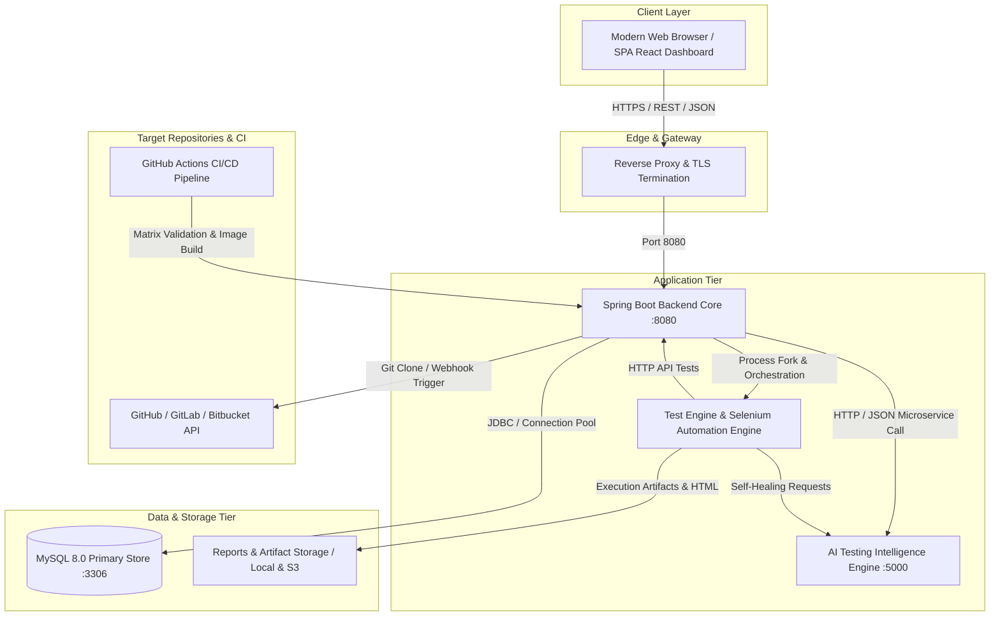
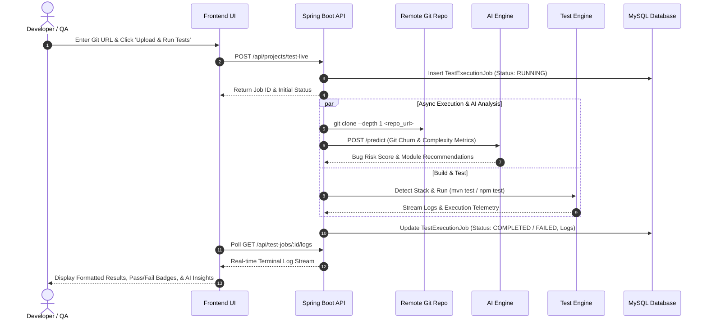

# System Architecture Specification

This document provides a comprehensive technical blueprint of the **AI-Based Automated Software Testing Platform**, covering system topology, component interactions, scalability models, and fault-tolerance boundaries.

---

## 1. High-Level System Architecture (C4 Container Diagram)

---

## 2. Layered Architecture Principles

### 1. Presentation Layer (React 18 Dashboard)
- **Role-Based Views:** Admin, Developer, and QA views with contextual action buttons.
- **Real-Time Telemetry:** Continuous polling and asynchronous job status stream.
- **Glassmorphic Cyber-Aesthetic:** Designed for maximum visual impact with glowing status cards, dark cyber palette, and animated state transitions.

### 2. Application Core (Spring Boot 3.2.x)
- **Modular Monolith Architecture:** Decoupled into `controller`, `service`, `entity`, `repository`, and `security`.
- **Security:** Spring Security 6 with BCrypt credential hashing, stateless JWT session tokens, and strict CORS policies.
- **Live Project Testing Service:** Clones Git repositories asynchronously, detects project build stack (`pom.xml`, `package.json`, `pyproject.toml`), runs containerized tests, and pipes console output.

### 3. AI Intelligence Layer (Python 3.11 / Flask)
- **Predictive Risk Modeling:** Scikit-learn Gradient Boosting regressor assessing defect probability from code churn and complexity.
- **NLP Test Synthesis:** Natural Language requirements parser transforming user stories into executable Given-When-Then BDD scenarios.
- **Self-Healing Locator Resolver:** Dynamic attribute distance and CSS/XPath fallback generator that rescues broken UI tests.

### 4. Automation & Execution Layer (Selenium 4 + TestNG)
- **Page Object Model (POM):** Decoupled page elements from execution logic.
- **SelfHealingDriver:** Automatic catch-and-recover wrapper intercepting `NoSuchElementException`.

### 5. Persistence Layer (MySQL 8.0)
- Fully normalized relational schema with foreign key cascading, unique constraints, and composite indexes on query paths.

---

## 3. End-to-End Test Execution Sequence

