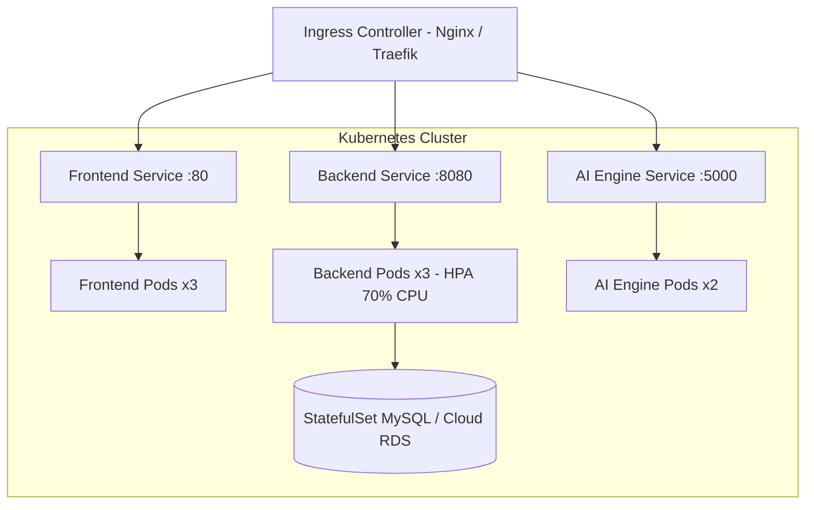

# Production Deployment & Infrastructure Guide

This guide details steps for deploying the **AI-Based Automated Software Testing Platform** across bare-metal environments, Docker containers, and Kubernetes clusters.

---

## 1. Local Containerized Orchestration (Docker Compose)

The repository provides a pre-configured `docker-compose.yml` defining the complete multi-tier stack:

```bash
# 1. Clone repository
git clone https://github.com/Gaurav-Khaladkar/AI-Based-Automated-Software-Testing-Platform.git
cd AI-Based-Automated-Software-Testing-Platform

# 2. Build and launch all services in detached mode
docker-compose up --build -d

# 3. Verify container health
docker-compose ps
```

### Port Map
- **Frontend Dashboard:** `http://localhost:3000`
- **Spring Boot API:** `http://localhost:8080`
- **AI Intelligence Engine:** `http://localhost:5000`
- **MySQL Database:** `localhost:3307`

---

## 2. Kubernetes Cloud Deployment (Architecture)



---

## 3. Environment Variables Reference

| Variable | Default Value | Purpose |
|---|---|---|
| `SPRING_DATASOURCE_URL` | `jdbc:mysql://db:3306/ai_testing` | Relational database connection string |
| `SPRING_DATASOURCE_USERNAME` | `root` | Database master user |
| `SPRING_DATASOURCE_PASSWORD` | `root` | Database master password |
| `JWT_SECRET` | `MySecretKey123` | Signing secret for authentication tokens |
| `AI_ENGINE_HOST` | `http://ai-engine:5000` | Backend link to Flask microservice |
| `PORT` | `5000` | AI Engine internal port |
