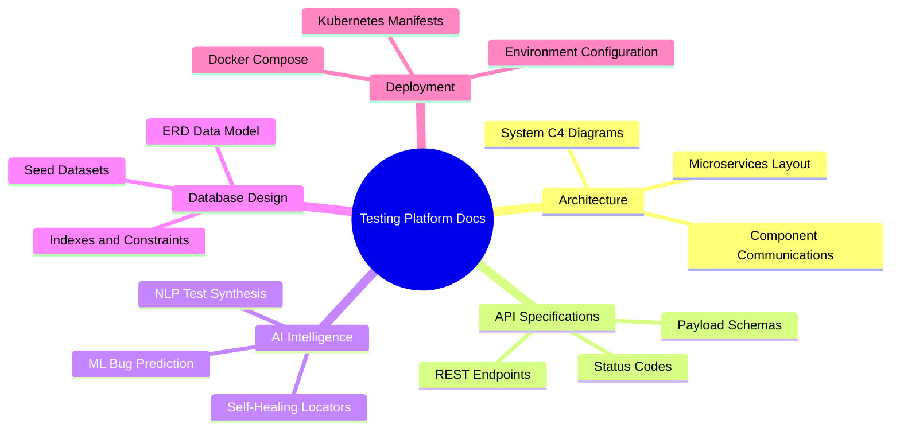

# Platform Engineering Documentation Portal

Welcome to the comprehensive technical documentation repository for the **AI-Based Automated Software Testing Platform**.

---

## 1. Documentation Index

- [System Architecture](file:///docs/ARCHITECTURE.md) — Comprehensive component specifications, C4 container models, and request lifecycles.
- [REST API Specification](file:///docs/API_SPECIFICATION.md) — Exhaustive catalog of endpoints, payload structures, and response schemas.
- [AI & ML Testing Intelligence Guide](file:///docs/AI_MODELS_GUIDE.md) — Mathematical foundations of bug risk prediction, NLP test case synthesis, and self-healing algorithms.
- [Production Deployment Guide](file:///docs/DEPLOYMENT_GUIDE.md) — Orchestration runbooks for Docker, Kubernetes, and Cloud native hosting.
- [Database Schema & Data Dictionary](file:///database/README.md) — Complete relational schema diagrams and table catalogs.
