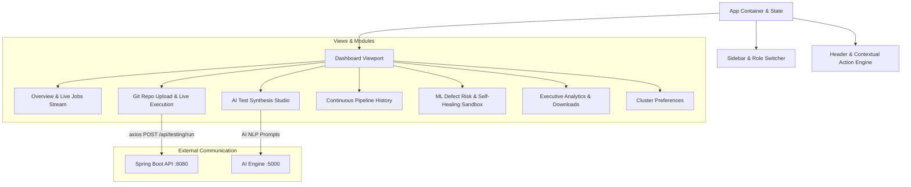

# Frontend Operations Dashboard (React 18)

The **Frontend Operations Dashboard** provides a real-time, glassmorphic Cyber-Dark user interface for monitoring automated test runs, testing remote Git repositories, interacting with the AI Test Generation Studio, and inspecting machine learning risk heatmaps.

---

## 1. Frontend Architecture & Flow (Mermaid)



---

## 2. Features

- **Cyber-Dark Glassmorphic UI:** Built with custom vanilla CSS tokens, radial gradients, backdrop blurs, and responsive cards.
- **Dynamic RBAC Role Switcher:** Switch between `ADMIN`, `DEV`, and `QA` modes on the fly.
- **AI Test Synthesis Studio:** Interactive Natural Language prompt playground that synthesizes BDD/API test cases with Given/When/Then steps.
- **Self-Healing Locator Demo:** Interactive sandbox showing runtime locator recovery and confidence scoring.
- **Live Terminal Console:** Live log streaming for cloned GitHub repository test runs.

---

## 3. Quickstart

```bash
cd frontend
npm install
npm start
```
Runs at `http://localhost:3000`.
