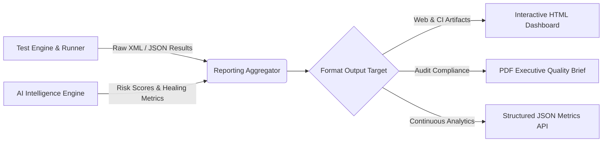

# Automated Reporting & Analytics Engine

The **Reporting Engine** aggregates test results from unit, API, and UI automation suites, integrates AI defect predictions, and compiles interactive executive dashboards in HTML, PDF, and JSON formats.

---

## 1. Analytics & Reporting Dataflow (Mermaid)



---

## 2. Report Formats & Features

| Format | File Pattern | Highlights |
|---|---|---|
| **HTML** | `latest_execution_report.html` | Cyber-dark theme, pass/fail metrics, AI self-healing audit log, responsive tables |
| **JSON** | `sample_execution_report.json` | Comprehensive telemetry format for CI/CD status reporting and REST API consumption |
| **CSV** | `failure_trends.csv` | Historical failure trends for root-cause statistical analysis |

---

## 3. CLI Generation

```bash
# Generate HTML report from latest execution JSON
python reports/generator.py
```
