# Test Engine Architecture & Test Automation Harness

The **Test Engine** is the core execution runner for automated API, unit, and regression testing suites across multi-environment matrices.

---

## 1. Test Engine Workflow (Mermaid)

```mermaid
sequenceDiagram
    autonumber
    participant UI as Web Dashboard
    participant Backend as Spring Boot API
    participant Runner as Test Engine (REST-Assured/TestNG)
    participant AI as AI Engine (Flask)
    participant DB as MySQL DB

    UI->>Backend: Trigger Test Run (project_id, env_id)
    Backend->>DB: Create Test Run Record (Status: RUNNING)
    Backend->>Runner: Dispatch Test Suite Execution
    
    rect rgb(20, 30, 45)
        note over Runner,AI: Execution & Self-Correction Loop
        Runner->>Backend: Execute /api/test-jobs Verification
        Runner->>AI: Validate Bug Risk & NLP Synthesizer
        alt Locator or Flaky Anomaly Detected
            Runner->>AI: POST /self-heal (DOM context)
            AI-->>Runner: Healed Selector + 98% Confidence
            Runner->>Runner: Re-execute assertion with healed locator
        end
    end

    Runner-->>Backend: Return Aggregated Test Telemetry (Pass/Fail, Duration)
    Backend->>DB: Update Test Run (Status: PASSED, Metrics)
    Backend-->>UI: Push Real-Time Results via WebSockets/Polling
```



---

## 2. Directory Layout

```text
test-engine/
├── pom.xml                 # Maven dependencies (TestNG 7.9, REST-Assured 5.4, Jackson)
├── testng.xml              # TestNG suite runner XML configuration
└── src/main/java/com/aitest/engine/
    ├── ApiTestRunner.java         # REST-Assured end-to-end integration test suite
    ├── UnitExecutionHarness.java  # Fast multi-threaded unit test execution runner
    └── FlakyTestAnalyzer.java     # Historical run variance and flip-rate calculator
```

---

## 3. Running the Test Suite

```bash
# Execute full API regression suite
mvn -f test-engine/pom.xml test

# Target custom backend host
mvn -f test-engine/pom.xml test -Dbackend.url=http://localhost:8080 -Dai.engine.url=http://localhost:5000
```
